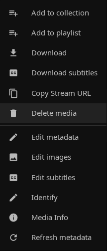

# Subtitle Download for Jellyfin

Adds **Download subtitles** immediately below **Download** in the movie or
episode popup menu. Click it to save all detected subtitle tracks in one ZIP.

The plugin includes its own web integration. Install the plugin and refresh
your browser. There are no scripts to paste or settings to configure.



## Install

Requires Jellyfin **12.3** and its bundled FFmpeg.

1. Open **Dashboard → Plugins → Repositories** and add a repository named
   **Subtitle Download** with this URL:

   ```text
   https://raw.githubusercontent.com/sjtrny/jellyfin-plugin-subtitle-download/main/manifest.json
   ```

2. Open **Catalog**, select **Subtitle Download**, and click **Install**.
3. Restart Jellyfin, then refresh the browser.
4. Open a movie or episode's **⋮** menu and click **Download subtitles**.

### Manual installation

1. Download the plugin ZIP from [GitHub Releases](https://github.com/sjtrny/jellyfin-plugin-subtitle-download/releases/latest).
   Extract it into a new `Subtitle Download_1.0.0.0` folder
   inside Jellyfin's `plugins` directory. For the official Docker image this
   is `/config/plugins/Subtitle Download_1.0.0.0/`.
2. Restart Jellyfin, then refresh the browser.
3. Open a movie or episode's **⋮** menu and click **Download subtitles**.

Keep the DLL directly inside that plugin folder. The plugin automatically
loads its web code and does not alter Jellyfin's installed web files. To
remove it, uninstall **Subtitle Download** in the dashboard and restart.

## Downloads

- Existing subtitle files retain their contents. Filenames are preserved
  except for unsafe characters and unusually long names. External VobSub
  tracks include both `.idx` and `.sub` files.
- Embedded SRT, ASS and WebVTT tracks keep their format. Embedded PGS uses
  `.sup`; DVD bitmap subtitles use subtitle-only Matroska (`.mks`). Other
  supported text formats are exported as SRT. No OCR is performed.
- Embedded filenames identify the language, track number and forced/SDH
  flags. Alternate video versions are grouped into separate folders.
- If a track cannot be read or extracted, the ZIP contains the successful
  tracks and `SUBTITLE-EXPORT-ERRORS.txt`; the web UI reports the failure count.
  A video with no subtitles has a disabled button.
- Jellyfin's download permission and item access checks apply. Subtitle
  management permission is not required. Subtitle files must be local to
  the server; this plugin does not fetch new subtitles from providers.

Use **Cancel** while an export is being prepared to stop it. Two exports can
run at once. Temporary files are removed after the response completes or
the request is cancelled. The browser receives one ZIP and does not need
permission to download multiple files.

The button is available in the web client served by this Jellyfin server.
Native client interfaces and separately hosted web clients do not load the
web integration. Web menu changes in later Jellyfin releases may require
a plugin update.

## Build

With the .NET 10 SDK and Python 3:

```sh
dotnet publish src/Jellyfin.Plugin.SubtitleDownload.csproj -c Release
python3 scripts/package.py
```

The release archive and a separate source archive are written to `artifacts/`,
with SHA-256 checksums. The release contains the plugin DLL, metadata, this
guide and the licence. Jellyfin assemblies are not bundled. Packaging also
updates `manifest.json` with the archive checksum required by Jellyfin.

To publish a new version, update the project version, build and package it,
then commit the source and manifest. Tag that commit as `vVERSION` and upload
the generated ZIPs and checksum files to the matching GitHub release. The
manifest's download URL must resolve to the exact archive that was packaged.

See [tests/README.md](tests/README.md) in the source archive for the real-server
and browser checks.
